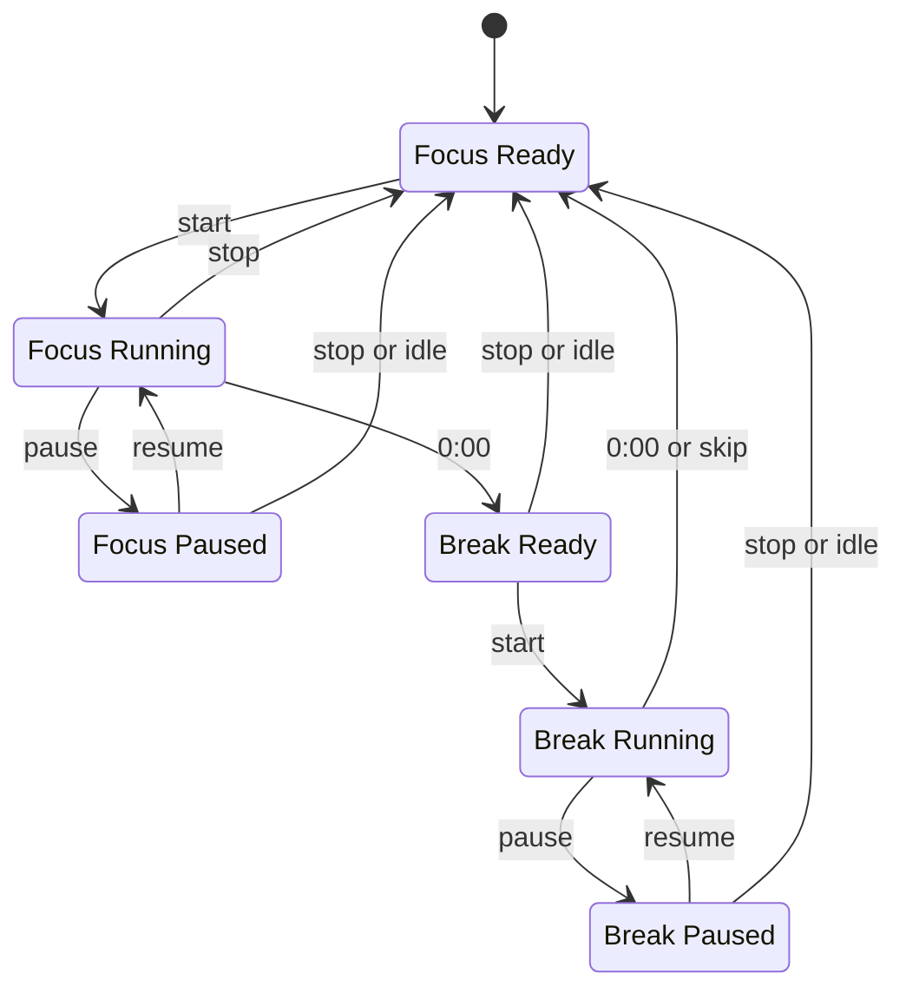

# Design

Pomodoro Pill is a Windows-only desktop timer built with Tauri 2. Rust owns the
timer, settings, window behavior, audio, and tray. The web UI is vanilla
TypeScript and CSS; it renders snapshots from Rust and sends commands back. No
timer logic lives in the UI.

This is the public map of the code and the visual system. For installation and
day-to-day use, see [`README.md`](../README.md).

## Overview

| Layer | Technology | Responsibility |
|---|---|---|
| Shell | Tauri 2 | Window, commands, events, tray, global shortcut, autostart |
| Core | Rust | Timer state, settings, Win32 behavior, audio |
| UI | Vanilla TypeScript + CSS | Render snapshots, handle clicks, hover, drag |
| Build | Vite + npm + Cargo | Frontend bundle and NSIS installer |

The app is a 284 x 106 logical-pixel transparent window. The visible pill is
58 px high and uses a fully rounded capsule shape. Fonts and sounds are bundled;
the app makes no network requests.

## Project map

| Path | Role |
|---|---|
| `src-tauri/src/main.rs` | App setup, plugins, window, tray, hotkey, audio |
| `src-tauri/src/engine.rs` | Pure timer state machine. No Tauri, I/O, or clock access |
| `src-tauri/src/runtime.rs` | 250 ms tick loop, snapshot events, phase-end events |
| `src-tauri/src/commands.rs` | Tauri commands and snapshot emission |
| `src-tauri/src/win32.rs` | No-activate, topmost, virtual desktops, position |
| `src-tauri/src/sys_events.rs` | Message-only window for lock, logoff, and suspend |
| `src-tauri/src/tray.rs` | Tray menu, show/hide, settings entry point |
| `src-tauri/src/audio.rs` | Dedicated audio thread and embedded WAV playback |
| `src-tauri/src/settings.rs` | JSON load/save, validation, atomic writes |
| `ui/index.html` | DOM structure for the pill and controls |
| `ui/main.ts` | Snapshot rendering, commands, hover, stop arming, drag save |
| `ui/style.css` | Theme tokens, geometry, and the seven visual states |
| `ui/fonts/` | Bundled Inter and JetBrains Mono woff2 files and licenses |

## Runtime flow

1. `main.rs` loads settings, builds `Engine::new(Config)`, and starts the tick
   loop, audio thread, session-event thread, tray, hotkey, and window setup.
2. `runtime.rs` wakes every 250 ms. It drains pending `RuntimeSignal` values
   (suspend or toggle), calls `engine.tick(now)`, takes a snapshot, drops the
   engine lock, and emits only when the snapshot changed.
3. When a phase ends, the runtime emits `engine://phase_ended` and sends the
   finished phase to the audio thread.
4. UI commands call into Rust. Each command takes `Instant::now()`, mutates the
   engine, emits `engine://snapshot`, and returns the new snapshot.
5. On window move, the UI debounces for 300 ms, then invokes `save_position`.
   Rust waits another 500 ms and writes the physical window position.
6. The UI re-fetches a snapshot on load and when the page becomes visible.

The engine mutex is never held across an event emit or an await. The tick loop
clones the snapshot, releases the lock, then emits.

## Timer state machine

The engine has two phases and three statuses:

- Phase: `Focus` or `Break`
- Status: `Ready`, `Running`, or `Paused`

The valid states are Focus Ready, Focus Running, Focus Paused, Break Ready,
Break Running, and Break Paused.



Rules:

- Defaults are 25 minutes of focus, 5 minutes of break, and a 15-minute idle
  reset.
- A phase never starts by itself. At `0:00`, the engine moves to the next phase
  in the Ready state and emits one phase-end event.
- Remaining seconds round up, so `0:00` appears only at the true end.
- The warning state is true only for Focus Running with 60 seconds or less. It
  is false in Break and false while paused.
- Idle time in Paused, Break Ready, or Break Paused resets to Focus Ready after
  the idle timeout. Focus Ready and Running are not reset.
- Lock, logoff, sleep, and hibernate send a suspend signal. A running timer
  pauses and stays paused on return. A tick gap over 2 seconds is treated as an
  unseen suspend.
- Stop returns to Focus Ready from any state. Skip returns to Focus Ready from
  Break and does nothing in Focus.
- Every time-dependent engine method takes `now: Instant`. The engine never
  calls `Instant::now()` itself.

## UI states and theme

### Visual states

| State | Content | Accent |
|---|---|---|
| Focus Ready | Hollow dot, `25:00`, Start button | Cream |
| Focus Running | Filled dot, time, 3 px progress track | Tomato |
| Focus Warn | Coral time and stronger glow at 60 seconds or less | Coral |
| Focus Paused | Hollow dot, dim time, frozen track | Tomato at 50% |
| Break Ready | Cup icon, “Break Time!”, `05:00 ready`, Start button | Leaf |
| Break Running | Filled leaf dot, time, progress track | Leaf |
| Break Paused | Hollow leaf dot, dim time, frozen track | Leaf at 50% |

Geometry and interaction:

- Window: 284 x 106 px, transparent, with the pill vertically centered and
  24 px from the left edge.
- Pill height: 58 px. Widths: 172 px at rest, 236 px on hover, 210 px in Ready
  states.
- The pill widens on hover with a 300 ms ease. Controls fade in after a short
  delay.
- Stop is two-step: the first click arms “Stop?” for 2 seconds; the second
  click confirms. During a break, the same button is Skip.
- The progress track is 3 px high. The fill width is the elapsed fraction of
  the phase.
- The phase-end flash is a one-shot 600 ms glow. There are no looping
  animations and no `backdrop-filter`.

### Palette

The logo lives at `src-tauri/icons/source/icon-full.svg`. The interface derives
its colors from the tomato, leaf, and cream in that mark.

| Token | Value | Use |
|---|---|---|
| `--tomato` | `#F0432C` | Focus accent |
| `--tomato-deep` | `#D92A18` | Focus pressed state and gradient end |
| `--coral` | `#FF8A74` | Focus warning accent |
| `--leaf` | `#6CC24A` | Break accent |
| `--leaf-deep` | `#3E9B3A` | Break pressed state and gradient end |
| `--cream` | `#FFF4EC` | Text and Start button |
| `--berry` | `#B3261E` | Text on the cream Start button |
| `--blush` | `#F7B1B1` | Armed Stop text and subtle hover tint |
| `--bg` | `rgba(30,20,18,0.94)` | Pill background |
| `--bg-raised` | `rgba(255,244,236,0.07)` | Control wells |
| `--bg-raised-hover` | `rgba(255,244,236,0.14)` | Control hover |
| `--stroke` | `rgba(255,244,236,0.12)` | 1 px inner hairline |
| `--trough` | `rgba(255,244,236,0.10)` | Progress track background |
| `--text` | `#FFF4EC` | Time and primary text |
| `--text-dim` | `rgba(255,244,236,0.60)` | Paused time and secondary text |

Typography:

- Inter for labels and buttons.
- JetBrains Mono for the time, with tabular numbers and a zero slash.
- Time: 22 px, weight 600. Start button: 13 px, weight 600. “Break Time!”:
  15 px, weight 600. Ready sub-label: 10 px, weight 500.
- Both fonts are local woff2 files under `ui/fonts/`. There is no CDN.

## Windows behavior

- **No activation:** The window gets `WS_EX_NOACTIVATE` and
  `WS_EX_TOOLWINDOW`, and clears `WS_EX_APPWINDOW`. Clicking the pill does not
  take focus from the app the user is typing in. The styles are re-applied
  after the window is shown.
- **Always on top:** A foreground event hook re-asserts `HWND_TOPMOST` with
  `SWP_NOACTIVATE`. A 5-second timer repeats the re-assert as a fallback.
- **Virtual desktops:** A best-effort `IVirtualDesktopManager` follow moves the
  pill to the foreground window's desktop on a foreground event and once per
  second. Failures are logged once and ignored.
- **Lock and sleep:** A message-only window receives Windows session and power
  notifications. Lock, logoff, and suspend send a pause signal to the engine.
- **Position:** The window saves physical pixels after a drag. On launch, the
  saved position is validated against a monitor and clamped so the pill stays
  inside the work area. The default is the top-right of the primary monitor
  with a 16 px margin. Tray “Reset position” clears the saved position.
- **Fullscreen watcher:** The optional “Hide in fullscreen” setting checks the
  Windows notification state every 2 seconds and hides the pill in fullscreen
  apps.
- **Single instance:** A second launch shows the existing pill instead of
  creating a new timer.
- **Hotkey:** `Ctrl+Alt+P` toggles start, pause, and resume. Registration
  failure is logged and does not stop the app.
- **Tray:** Left-click toggles visibility. The menu has Sound, Start with
  Windows, Hide in fullscreen, Reset position, Open settings file, and Quit.
- **Audio:** A dedicated `rodio` thread plays embedded WAV files. Volume and the
  sound toggle come from settings. A missing audio device is logged and the app
  continues.

## Settings

The settings file is:

```text
%APPDATA%\PomodoroPill\settings.json
```

The app reads it at startup. A missing or corrupt file falls back to defaults.
Writes are atomic: a temporary file is written, then renamed over the original.

```json
{
  "focus_min": 25,
  "break_min": 5,
  "idle_reset_min": 15,
  "sound": true,
  "volume": 0.6,
  "autostart": false,
  "hide_in_fullscreen": false,
  "pos": null
}
```

| Field | Default | Meaning |
|---|---:|---|
| `focus_min` | 25 | Focus length in minutes |
| `break_min` | 5 | Break length in minutes |
| `idle_reset_min` | 15 | Idle reset threshold in minutes |
| `sound` | true | Play a sound when a phase ends |
| `volume` | 0.6 | Playback volume from 0.0 to 1.0 |
| `autostart` | false | Start the app with Windows |
| `hide_in_fullscreen` | false | Hide the pill in fullscreen apps |
| `pos` | null | Last physical window position; managed by the app |

Durations are clamped to at least 1 minute. Volume is clamped to 0.0–1.0.
Changes to the file apply after restart. Tray toggles save immediately.

## Build and test

Prerequisites:

- Windows 10/11 x64
- Rust stable with the MSVC toolchain
- Node.js 20 or newer
- Microsoft C++ Build Tools with the Windows SDK
- WebView2 runtime

Run the app in development:

```powershell
npm install
npm run tauri dev
```

Run the checks:

```powershell
npm run build
cargo fmt --manifest-path src-tauri/Cargo.toml -- --check
cargo clippy --manifest-path src-tauri/Cargo.toml -- -D warnings
cargo test --manifest-path src-tauri/Cargo.toml
```

Build the installer:

```powershell
npm run tauri build
```

The NSIS installer is written to:

```text
src-tauri/target/release/bundle/nsis/Pomodoro Pill_0.1.0_x64-setup.exe
```

The engine tests cover pause and resume accuracy, deadline transitions, late
ticks, idle reset, suspend behavior, warn thresholds, rounding, stop, skip,
toggle, and invalid calls.
